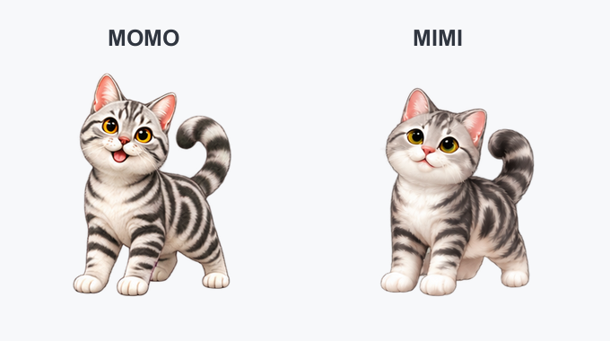

```{=html}
<header class="page-intro"><p class="eyebrow">A little about me</p><h1>Hello, I’m Shanlong.</h1><p class="lead">Making health data easier to access, understand, and use.</p></header>
<div class="about-layout"><div class="prose">
<h2>My work</h2>
<p>I work on health information and data science at the WHO Regional Office for the Western Pacific, based in Manila.</p>
<p>My work focuses on health indicator monitoring, mortality analysis, and reproducible workflows in R. I also develop open-source tools and learning materials to help people understand data, carry out analyses, and communicate results clearly.</p>
<h2>This website</h2>
<p>This is a home for my public projects, technical guides, and practical lessons. Explore the <a href="/projects/">projects</a> to find a tool, or browse <a href="/notes/">notes and tutorials</a> for an approach you can use in your work.</p>
<h2 id="contact">Get in touch</h2>
<p>I welcome conversations about health data analysis, R tools, and data training.</p>
<p><a href="mailto:dings@who.int">dings@who.int</a><br><a href="https://github.com/shanlong-who">GitHub · shanlong-who</a></p></div>
<aside><div class="portrait-frame"></div><ul class="about-facts"><li><span>Name</span>Shanlong Ding · 丁善龙</li><li><span>Based in</span>Manila, Philippines</li><li><span>Focus</span>Public health · Data science</li></ul></aside></div>
<section class="beyond"><div><p class="eyebrow">Beyond data</p><h2>MOMO &amp; MIMI</h2><p>Two small desktop cats that move, play, and keep a little company. A project made for fun, and a lighter corner of my public work.</p><a class="text-link" href="https://github.com/shanlong-who/MOMO">Meet MOMO &amp; MIMI <span aria-hidden="true">↗</span></a></div><figure class="pet-preview"></figure></section>
```
