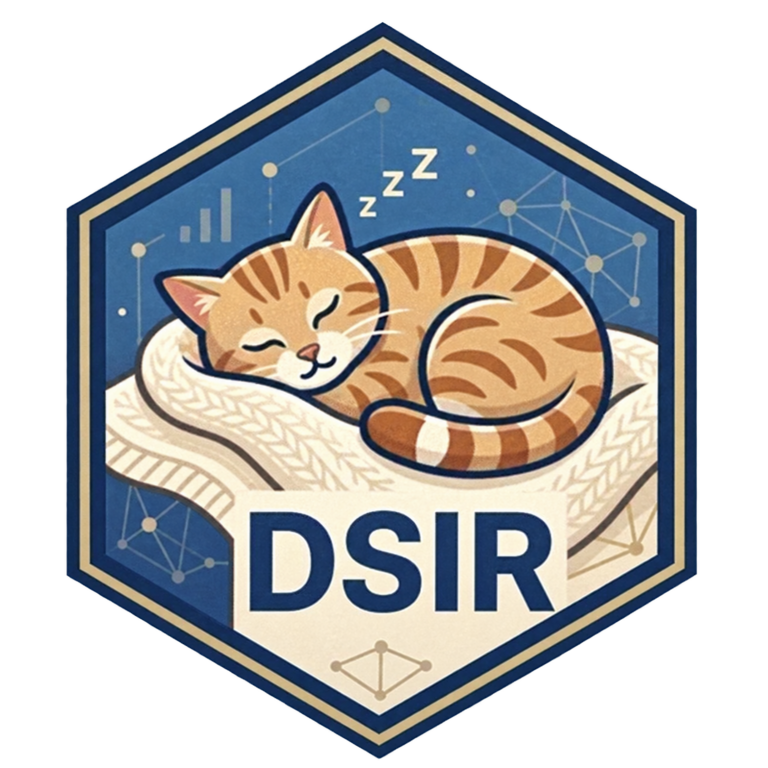

```{=html}
<header class="case-header"><div><p class="breadcrumb"><a href="/projects/">← All projects</a></p><p class="eyebrow">R package</p><h1>DSIR</h1><p class="lead">Access WHO and UN data, work with country metadata, and create consistent charts and tables.</p><div class="button-row"><a class="button" href="https://shanlong-who.github.io/DSIR/">Read the guide <span aria-hidden="true">↗</span></a><a class="text-link" href="https://github.com/shanlong-who/DSIR">View source <span aria-hidden="true">↗</span></a></div></div><a class="project-art" href="https://shanlong-who.github.io/DSIR/" aria-label="DSIR"><span class="art-index" aria-hidden="true">01</span></a></header>
<div class="case-layout"><article class="prose"><h2>The question</h2><p>How can routine health-data work become easier to repeat, from retrieving observations to producing clear outputs?</p>
<h2>What the package offers</h2><p>DSIR brings together data clients for WHO GHO, WHO GHE, and UN SDG sources, country metadata, and reusable plotting and table styles. Its documentation describes the source-specific functions and their arguments.</p>
<h2>Who it is for</h2><p>Analysts who work in R with health indicators and need consistent data-access and reporting workflows.</p>
<h2>A starting point</h2><p>Install the package from CRAN with <code>install.packages("DSIR")</code>, then open its help index:</p><pre><code>library(DSIR)
help(package = "DSIR")</code></pre>
<h2>Using the results</h2><p>Check the indicator definition, units, population, time coverage, and source before comparing observations. Use the project documentation to distinguish the CRAN release from GitHub development features.</p>
<h2>My contribution</h2><p>I am the package author and maintainer. The repository contains the current package metadata, source code, documentation, and licence.</p></article><aside class="case-meta" aria-label="Project details"><dl><dt>Format</dt><dd>R package</dd><dt>My role</dt><dd>Author and maintainer</dd><dt>Licence & attribution</dt><dd>MIT + licence file</dd><dt>Source</dt><dd><a href="https://github.com/shanlong-who/DSIR">DSIR · GitHub</a><br>Description checked on 3 November 2026.</dd></dl></aside></div>
<a class="back-link" href="/projects/">← Back to all projects</a>
<section class="contact-band"><div><h2>Have a question about this work?</h2><p>Get in touch about use cases, methods, and data training.</p></div><a href="mailto:dings@who.int">dings@who.int <span aria-hidden="true">↗</span></a></section>
```
