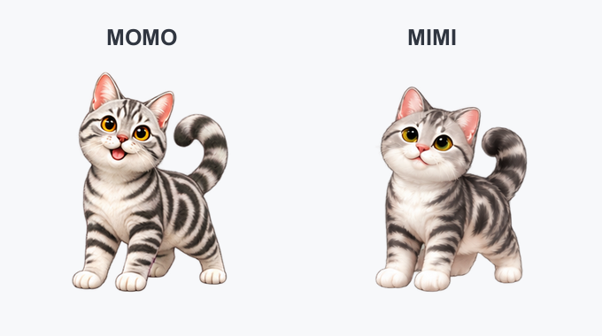

```{=html}
<header class="page-intro"><p class="eyebrow">关于我</p><h1>你好，我是丁善龙。</h1><p class="lead">让健康数据更容易获取、理解和使用。</p></header>
<div class="about-layout"><div class="prose">
<h2>我的工作</h2>
<p>我目前在世界卫生组织西太平洋区域办事处从事健康信息与数据科学工作，常驻马尼拉。</p>
<p>我的工作关注健康指标监测、死亡率分析，以及使用 R 构建可重复的数据分析流程。我也开发开源工具和学习材料，帮助更多人理解数据、开展分析并清楚地表达结果。</p>
<h2>这个网站</h2>
<p>这里汇集了我的公开项目、技术指南和实践经验。你可以从 <a href="/zh/projects/">项目页</a>了解工具，或在 <a href="/zh/notes/">文章与教程</a>中寻找与当前工作相关的方法。</p>
<h2 id="contact">联系我</h2>
<p>欢迎交流健康数据分析、R 工具和数据培训。</p>
<p><a href="mailto:dings@who.int">dings@who.int</a><br><a href="https://github.com/shanlong-who">GitHub · shanlong-who</a></p></div>
<aside><div class="portrait-frame"></div><ul class="about-facts"><li><span>姓名</span>Shanlong Ding · 丁善龙</li><li><span>所在地</span>菲律宾，马尼拉</li><li><span>工作方向</span>公共卫生 · 数据科学</li></ul></aside></div>
<section class="beyond"><div><p class="eyebrow">数据之外</p><h2>MOMO &amp; MIMI</h2><p>两个可以在桌面上走动、互动的小猫。这个小项目给日常工作添了一点乐趣，也是我公开作品中轻松的一角。</p><a class="text-link" href="https://github.com/shanlong-who/MOMO">认识 MOMO 与 MIMI <span aria-hidden="true">↗</span></a></div><figure class="pet-preview"></figure></section>
```
