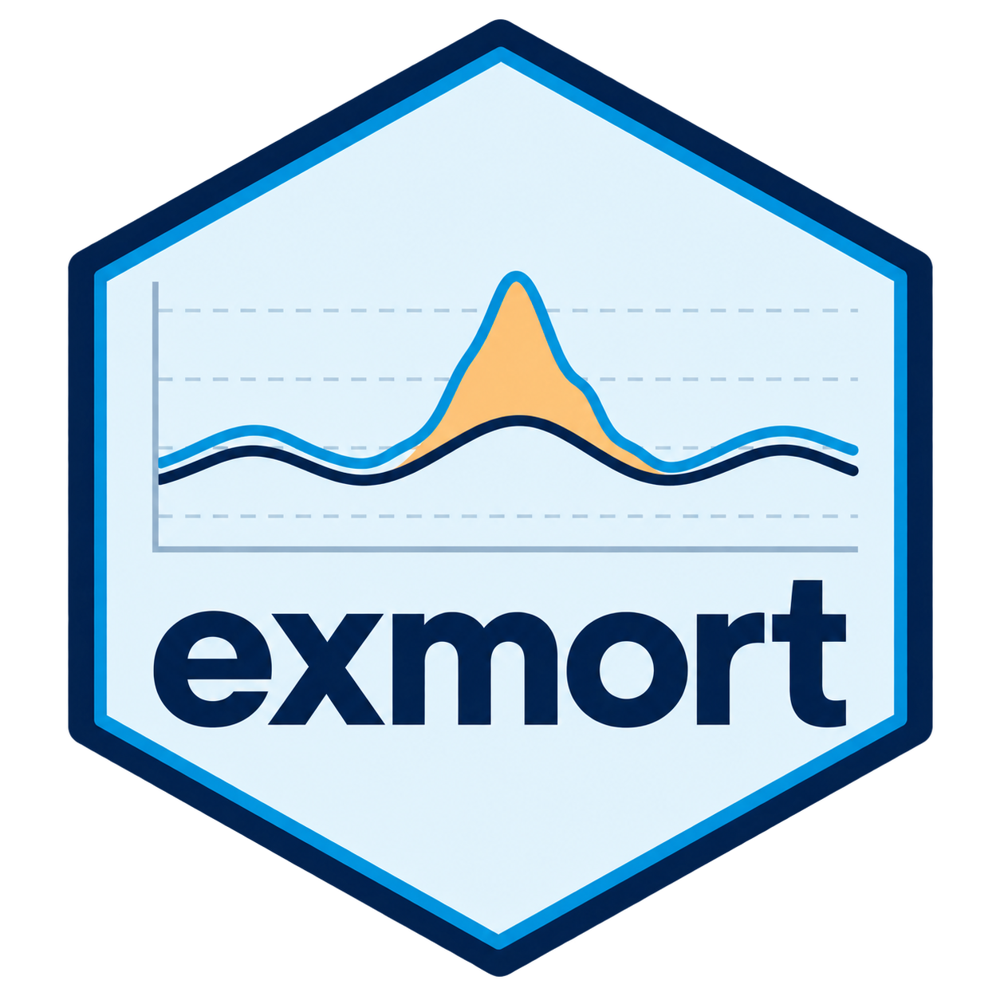

```{=html}
<header class="page-intro"><p class="eyebrow">公开项目</p><h1>把问题变成可用的工具。</h1><p class="lead">这些项目涵盖健康数据获取、死亡率分析、交互探索与数据培训。每个项目都有独立的文档和源代码。</p></header>
<div class="project-list"><article class="project-entry"><a class="project-art" href="/zh/projects/dsir.html" aria-label="DSIR"><span class="art-index" aria-hidden="true">01</span></a><div><p class="kicker">R 数据工具包</p><h2>DSIR</h2><p>获取 WHO 与 UN 数据，使用国家元数据，并生成风格一致的图表与表格。</p><div class="button-row"><a class="button" href="/zh/projects/dsir.html">了解项目 <span aria-hidden="true">↗</span></a><a class="text-link" href="https://shanlong-who.github.io/DSIR/">阅读指南（英文） <span aria-hidden="true">↗</span></a></div></div></article>
<article class="project-entry"><a class="project-art" href="/zh/projects/exmort.html" aria-label="exmort"><span class="art-index" aria-hidden="true">02</span></a><div><p class="kicker">死亡率分析</p><h2>exmort</h2><p>利用基线模型分析全因死亡与超额死亡，查看图表并导出报告。</p><div class="button-row"><a class="button" href="/zh/projects/exmort.html">了解项目 <span aria-hidden="true">↗</span></a><a class="text-link" href="https://shanlong-who.github.io/exmort/">阅读指南（英文） <span aria-hidden="true">↗</span></a></div></div></article>
<article class="project-entry"><a class="project-art" href="/zh/projects/catascience.html" aria-label="cataScience"><span class="art-index" aria-hidden="true">03</span></a><div><p class="kicker">学习与培训</p><h2>cataScience</h2><p>通过交互课程和实际练习，学习整理、探索和解释数据。</p><div class="button-row"><a class="button" href="/zh/projects/catascience.html">了解项目 <span aria-hidden="true">↗</span></a><a class="text-link" href="https://shanlong-who.github.io/cataScience/">阅读指南（英文） <span aria-hidden="true">↗</span></a></div></div></article>
<article class="project-entry"><a class="project-art spar-art" href="/zh/projects/spar.html" aria-label="SPAR Insights"><span class="art-index" aria-hidden="true">04</span><strong>SPAR</strong><span>2021 — 2025</span></a><div><p class="kicker">交互仪表板</p><h2>SPAR Insights</h2><p>按年份、区域和国家探索公开的 SPAR 自评数据。</p><div class="button-row"><a class="button" href="/zh/projects/spar.html">了解项目 <span aria-hidden="true">↗</span></a><a class="text-link" href="https://shanlong-who.github.io/spar-insights/">打开仪表板 <span aria-hidden="true">↗</span></a></div></div></article></div>
<aside class="small-note"><strong>选择合适的使用方式。</strong> SPAR Insights 可直接在浏览器中使用。DSIR 是 R 工具包；exmort 和 cataScience 的网页提供文档，交互应用需要在 R 中启动。</aside>
<section class="contact-band" aria-label="联系"><div><h2>从一个数据问题开始交流。</h2><p>欢迎交流健康数据分析、R 工具和数据培训。</p></div><a href="mailto:dings@who.int">dings@who.int <span aria-hidden="true">↗</span></a></section>
```
